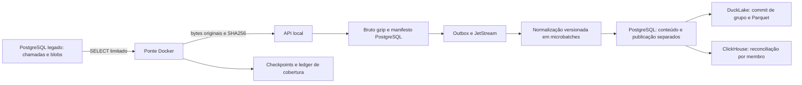

# Coleta contínua GMGN — operação e contrato

> Estado atual: a origem ativa é o [coletor direto](DIRECT_COLLECTOR.md), independente do legado. Este documento descreve a ponte histórica; ela permanece desligada.

Continuação autorizada S-DB-20260908-02. A ponte usa as respostas que o coletor existente já armazenou. Não faz requests GMGN, não abre uma conexão por token/estratégia e não executa operações financeiras.

## Fluxo implantado



Uma captura conserva `call_id`, `endpoint`, `chain` — inclusive null quando não existe adapter —, horários UTC originais, bytes exatos e dois hashes da origem. O ACK da API significa bruto e manifesto aceitos. Normalização e confirmação dos dois destinos são etapas posteriores.

Os parâmetros de transporte usam projeção permitida: cabeçalhos, credenciais e mensagens de erro livres não são copiados. `token_info` e `market_rank` conservam o contrato do importador anterior; outros endpoints preservam também from/to/resolution, horizonte, período, carteira(s), filtros e cursor conhecidos. Parâmetros novos fora da lista precisam revisão. O bruto aqui é o corpo original da resposta, não uma gravação integral da conexão HTTP.

## Escopo e cursor

O início fica persistido em DATA_BRIDGE_START_AT no arquivo privado bridge.env. O operador inicializa um minuto antes do relógio lido na origem. A identidade de cluster é conferida com pg_control_system; hostname, banco, papel, início e protocolo participam do vínculo do checkpoint. Uma configuração incompatível falha em vez de reaproveitar o cursor.

As consultas leem as duas categorias produzidas pelo legado: success e error, em pernas separadas compatíveis com seus índices parciais. Cada consulta retorna no máximo 50 metadados, dentro de uma janela de no máximo 60 segundos, ordenados por received_at e call_id. Os blobs são buscados individualmente pela chave primária depois dessa seleção.

Três percursos alternam páginas, com progresso persistente:

| Percurso | Finalidade |
|---|---|
| forward | Avançar desde o início configurado, com pequena margem de dois segundos em relação ao relógio da origem. |
| recent | Revisitar até dez minutos anteriores ao forward_until fixado no início de cada ciclo; pode estar atrás do relógio atual. |
| audit | Revisitar desde o início até o forward_until observado no começo do ciclo. A fronteira superior fica fixa durante esse ciclo. |

Um timestamp não é uma posição de commit. Uma chamada pode ser recebida antes de esperar por conexão e só aparecer depois. Por isso um ciclo concluído significa faixa revisitada, nunca histórico definitivamente fechado. A recuperação exige que as linhas/brutos continuem na origem e que os percursos voltem a progredir. Chamadas com received_at anterior ao início configurado não fazem parte desta cobertura, mesmo se commitadas depois. O custo e a duração do audit crescem com a faixa; CDC e migração histórica têm critérios próprios em [MIGRATION.md](MIGRATION.md).

A ordem é ACK durável → recibo da chamada confirmado → checkpoint da página. Falha antes do último passo repete a página. IDs já aceitos não relêem o blob. Alteração posterior da identidade/metadados da mesma chamada gera exceção e conserva o fingerprint original.

## Microbatches e persistência

Um microbatch é um grupo transitório para amortizar commits. Cada captura e cada interpretação conservam seus IDs, versão, hash de conteúdo, recibo e estado. O grupo não funde tokens, não cria conexões por estratégia e não substitui a identidade dos seus membros.

O worker busca até 8 mensagens por leitura do consumidor e processa grupos menores quando não há 8 itens ou quando o próximo item excederia o orçamento. Mensagens repetidas da mesma captura no grupo compartilham a interpretação e recebem seus ACKs após a publicação. Na etapa analítica, o worker seleciona até 8 interpretações publicadas, pendentes e elegíveis para tentativa. Itens sem retry marcado têm prioridade; os demais precisam ter atingido seu horário de retry. Esse grupo pode ser diferente do grupo usado para normalizar.

| Etapa | Máximo de membros | Máximo de fatos no grupo | Orçamento de dados |
|---|---:|---:|---|
| Persistência da normalização | 8 capturas distintas | 10.000 | 16 MiB: soma dos envelopes JSON compactos `{facts,fields}` de cada captura, em bytes UTF-8. |
| Aplicação analítica | 8 batch_ids distintos | 10.000 | 16 MiB: soma do JSON canônico das linhas de fatos enriquecidas; não inclui catálogo de campos nem a estrutura externa de transporte. |
| Confirmação de recibos analíticos | 8 batch_ids distintos | Contagem deve corresponder ao run | Identidade, resumo, dois destinos e snapshot válidos; run existente e publicado. Um membro inválido impede a confirmação do grupo. |

O dimensionamento usa `Store.normalization_size` no PostgreSQL e `batch_size` na etapa analítica. A contagem de caracteres Python não substitui bytes UTF-8. O orçamento de normalização conserva a regra individual de 16 MiB: issues continuam no hash imutável, mas ficam fora desse orçamento, assim como projeções NUMERIC e estruturas de SQL/COPY. Esses valores limitam admissão, não são um teto de RAM total do processo. Um item individual que excede o contrato não é truncado nem passa a caber apenas por dividir o grupo.

### Duas transações PostgreSQL para a normalização

1. **Conteúdo:** uma transação insere os runs do grupo, verifica o hash imutável de cada captura/versão e grava os novos fatos e campos com um COPY binário por tabela. O estado ready/quarantined segue as mesmas regras de issues da operação individual. Conflito de hash ou falha de COPY reverte todos os novos dados dessa transação.
2. **Publicação:** somente depois do commit de conteúdo, outra transação toma o lock exclusivo 60608003 e lê um único horário do banco. Ela publica a disponibilidade dos membros e confirma o consumo da outbox. Os leitores temporais usam o lado compartilhado desse lock. COALESCE preserva a disponibilidade original de runs, capturas e fatos já publicados em uma reentrega; o horário novo não reescreve o passado.

Uma queda entre as duas transações pode deixar conteúdo confirmado ainda sem disponibilidade. A reentrega confere o mesmo hash e conclui a publicação. O ACK do consumidor JetStream acontece depois dessa etapa; ele não depende da conclusão dos destinos analíticos. Se esse ACK se perder, a interpretação já publicada continua válida e a repetição confirma o recebimento sem reinterpretar seus dados.

As duas transações acima pertencem à normalização. Elas não representam o número total de commits do fluxo completo: publicação da outbox, ledger da ponte e confirmação posterior dos recibos analíticos têm seus próprios commits. As APIs individuais `record_normalization` e `mark_analytics` delegam a grupos de um membro, mantendo o caminho de recuperação por captura.

### DuckLake e ClickHouse

O DuckLake aplica os membros novos de um grupo em **uma transação/commit**, contendo fatos e um recibo individual para cada batch_id. O commit registra os pares batch_id/checksum dos membros. A verificação recupera, para cada membro, o snapshot que contém aquele par; membros novos podem apontar ao mesmo snapshot. Membros já confirmados preservam sua referência anterior, inclusive quando reaparecem junto a membros novos. Um snapshot geral do catálogo não substitui essa prova por membro.

Depois do DuckLake, o ClickHouse confere identidades e recibos, insere os fatos faltantes e os recibos ausentes. Essa etapa pode ficar parcialmente aplicada se uma chamada falhar. Não existe transação distribuída entre PostgreSQL, DuckLake e ClickHouse. Reentregar os mesmos batch_ids reconcilia o destino incompleto, sem tratar apenas o sucesso do primeiro destino como conclusão.

A confirmação exige validação estrita de cada membro antes da escrita:

- O batch_id interno do recibo deve coincidir com a chave solicitada. O resultado geral, lake e clickhouse precisam declarar sucesso; ambos os destinos precisam declarar recibo presente.
- Count é inteiro não negativo; checksum é SHA-256 hexadecimal; as contagens por origem são válidas e somam o total. Esses valores devem coincidir no resumo geral e nos dois destinos, junto da versão de schema esperada.
- As fronteiras de disponibilidade são comparadas como instantes UTC, sem confundir strings de offsets diferentes. Lote vazio usa fronteira nula. Snapshot exige escopo batch_commit, ID inteiro válido e horário com timezone explícito.
- Dentro da transação PostgreSQL, o run deve existir, estar publicado e ter fact_count igual ao recibo. Ausência ou divergência reverte todas as confirmações desse grupo.

Somente depois dessas verificações `mark_analytics_many` confirma os recibos e analytics_applied_at. Sucesso limpa analytics_retry_at e analytics_last_error, preservando analytics_attempts. Um simples ok=true, um recibo trocado ou um membro incompleto não conclui a etapa.

### Falhas, divisão do grupo e repetição

- Falha de persistência agrupada leva o worker a tentar cada captura pelo contrato individual. Vizinhos válidos podem avançar; a captura que continua falhando conserva erro visível e recebe nova tentativa por mensagem. Se a falha ocorreu após o commit de conteúdo, a tentativa individual reconcilia a publicação já pendente.
- Falha analítica agrupada leva a tentativas por batch_id. Uma falha individual ou na preparação agenda o próximo retry e registra o erro. Conflitos de conteúdo/validação seguem para os vizinhos sem espera artificial; indisponibilidade de destino interrompe a sequência de tentativas individuais após uma pausa curta, evitando uma rajada de requests.
- HTTP 409 ou ACK incerto na ponte continuam bloqueando o checkpoint da página. Esse protocolo é distinto do ACK do JetStream e dos recibos analíticos.
- Falhas e tentativas individuais podem aumentar novamente o número de commits. O ganho de agrupamento não remove validações, não torna itens problemáticos válidos e não garante prazo máximo de recuperação.

### Retry persistente e prioridade da fila

A migration 005 acrescenta analytics_retry_at, analytics_attempts e analytics_last_error ao run, além do índice parcial de interpretações publicadas ainda não aplicadas. `defer_analytics` usa o relógio PostgreSQL para agendar intervalos de **1, 2, 4, 8, 16, 32 e 60 segundos**, mantendo o teto de 60 segundos nas falhas seguintes. O contador cresce e o erro armazenado é apenas um código saneado com formato de classe de exceção, até 64 caracteres; mensagem livre, corpo e credenciais não são gravados nesse campo.

A seleção filtra retry_at nulo ou vencido e ordena por **analytics_retry_at NULLS FIRST, recorded_at, batch_id**. Assim, itens nunca reagendados têm prioridade sobre retries antigos, inclusive quando os deadlines desses retries já venceram. Isso corrige o caso reproduzido em que oito lotes inválidos antigos ocupavam sempre o LIMIT 8 e impediam a nona interpretação válida de avançar. O dado inválido continua identificado; não foi promovido como válido nem apagado para liberar a fila.

Só runs publicados e ainda pendentes podem ser reagendados. Reagendamento não altera available_at, conteúdo ou versões e não desfaz um aceite analítico já confirmado. Reinício conserva o prazo e a contagem no PostgreSQL. Os prazos são condições de elegibilidade, não promessa de execução naquele segundo nem limite total de duração da recuperação.

O [gate Docker de retry e grupos](../.data/gmgn-data/evidence/continuous-retry-groups.xml), iniciado em **2026-09-09 01:12:33.892571 UTC**, registra **67 elementos testcase, zero falhas, zero erros e zero skips**, com duração de 10,688 s. Inclui rollback/recibos, oito lotes problemáticos seguidos de um nono saudável e prioridade da primeira tentativa mesmo após retries vencidos. O contador agregado testsuite informa 69, sem nós adicionais de subcasos no XML; essa diferença não foi convertida em testes extras nesta documentação. Trata-se de um gate focado de correção e recuperação, não de medição de vazão ou aprovação da suíte completa.

Referências de implementação: `midas_data/worker.py` (planejamento, prioridade e fallback), `midas_data/store.py` (orçamento, transações, retry e recibos), `midas_data/analytics.py` (commit de grupo e verificação por membro) e `midas_data/migrations/005_analytics_retry.sql` (estado e índice).

## Estados e limites

| Estado da chamada | Significado |
|---|---|
| accepted | SHA/bytes, metadata e ACK conferidos; o ID aponta à captura persistida. Não significa que todos os seus campos foram interpretados. |
| unavailable | Erro sem corpo ou sucesso cujo corpo não foi retido pelo legado. Existe ledger e motivo; nenhum corpo é fabricado. |
| rejected | Hash, formato, limite, metadata ou identidade incompatível. Motivo e tentativas ficam visíveis e as releituras podem retentar. |

Falha HTTP, 409, desconexão ou ACK incerto interrompem a página sem promover o checkpoint. A mesma identidade será tentada novamente. Endpoints sem adapter podem ter bruto accepted e normalização quarantined/unsupported_endpoint; isso é distinto de erro de entrega.

Limites atuais: 4 MiB descompactados por resposta; 4 MiB + 64 KiB comprimidos; metadata de origem até 32 KiB antes de projeção; 50 chamadas por página; SQL na origem com statement_timeout de 5 s, lock_timeout de 1 s, work_mem de 4 MiB e uma conexão da ponte.

Desde DB-09.1, a captura não depende da contagem de pendências nem dos bytes cumulativos aceitos. GET /v1/admission e a escrita verificam espaço livre real, incluindo a sonda do volume físico do host. DATA_RAW_MIN_FREE_BYTES define reserva padrão de 4 GiB, acrescida do espaço da próxima captura. Os antigos guards de 500 pendências e 32 GiB foram substituídos; DATA_BRIDGE_RAW_BUDGET não é mais usado. Contrato, configuração e evidência em [ADMISSION.md](ADMISSION.md).

Estado ready indica atividade, não que a origem esteja acompanhada. Pausa por storage_backpressure conserva cursor e retoma quando houver espaço. Heartbeat recente dessa pausa mantém liveness saudável; ready_for_capture fica falso. degraded informa rejeições/falhas. O worker também pausa antes da próxima iteração sob pressão de armazenamento. Consulte atraso, filas e espaço; não existe retenção automática. O papel de origem limita conexões a duas e não altera tabelas.

## Comandos

Executar na raiz do repositório:

```powershell
pwsh -NoProfile -File scripts/gmgn-data-bridge.ps1 init
pwsh -NoProfile -File scripts/gmgn-data-bridge.ps1 up
pwsh -NoProfile -File scripts/gmgn-data-bridge.ps1 status
pwsh -NoProfile -File scripts/gmgn-data-bridge.ps1 stop
pwsh -NoProfile -File scripts/gmgn-data-bridge.ps1 start
```

init gera arquivo privado ignorado pelo Git e provisiona/verifica midas_data_reader: SELECT somente nas colunas necessárias de duas tabelas e leitura da identidade do cluster. Não altera tabelas, índices, dados, configurações globais ou serviços do legado. Não troca senha de um papel encontrado sem o arquivo correspondente. up usa imagem existente e não inicia dependências.

O serviço bridge está no perfil opcional ingestion, sem porta publicada, sem Docker socket, sem volumes de bruto/lake e com filesystem somente leitura. A rede legada alcança apenas esse novo serviço; API/worker continuam nas redes próprias. Credenciais ficam fora dos commits e dos backups.

GET /v1/status expõe `analytics_failures`: pending_count, next_retry_at e até 100 itens com batch_id, capture_id, versão, tentativas, retry e código de erro. Não inclui corpos nem mensagens livres. next_retry_at é o menor prazo registrado entre as falhas pendentes e pode já ter vencido; não é uma previsão exata de execução. Depois da confirmação, o item deixa a lista de falhas, mantendo sua contagem de tentativas no run.

GET /v1/ingestion, autenticado como as demais rotas de dados, retorna início, progresso, contadores, heartbeat e até 100 exceções. Contadores referem-se às chamadas descobertas; não são porcentagem de todo o histórico. GET /v1/catalog pode selecionar uma capture_id da origem informada ou até 20 capturas recentes, sempre na interpretação publicada mais recente. O resultado contém has_more/truncated, retorna até 1.000 itens e declara seu escopo. Não substitui o inventário completo preservado no bruto.

## Backup, recuperação e próxima camada

O [backup](BACKUP.md) pausa a ponte apenas se ela estava ativa, junto aos escritores da base nova, e a retoma em finally. O dump inclui checkpoints e ledger. RestoreCheck não inicia ponte/API/worker. A configuração privada da origem é fornecida separadamente numa recuperação operacional real; um ensaio de restore não a consome.

DATA_LEGACY_NETWORK e DATA_BRIDGE_ENV_FILE permitem testar a configuração de restore com rede e arquivo de origem ausentes. Não substituem a verificação do cluster/cursor numa retomada real.

Contratos interpretados: [FIELD_CONTRACTS.md](FIELD_CONTRACTS.md) e registro JSON gmgn-p0-v3. Os demais adapters, o restante da semântica, o backfill anterior ao início e a validação em escala continuam explicitamente separados. Estratégias, análises de trajetória e visualização de decisões pertencem às camadas seguintes.

Fontes do protocolo: [isolamento PostgreSQL](https://www.postgresql.org/docs/current/transaction-iso.html), [decodificação lógica](https://www.postgresql.org/docs/current/logicaldecoding-explanation.html), [perfis Docker Compose](https://docs.docker.com/compose/how-tos/profiles/). O contrato de cada campo aponta às fontes GMGNAI em FIELD_CONTRACTS.

## Capacidade e manutenção

Os microbatches amortizam commits da persistência e da confirmação analítica. O PostgreSQL mantém COPY binário; o DuckLake usa inserções JSON tipadas para os membros novos do grupo, conservando textos decimais sem passagem por float. No ClickHouse, a consulta global de identidades usa grupos de até 256 IDs, preservando o orçamento de 128 MiB lidos por consulta. A falha real era leitura excessiva (307), reproduzida também com parâmetros no corpo; não foi atribuída ao tamanho da URL. Essas mudanças preservam as verificações descritas acima; sua existência não demonstra que a vazão já acompanha a origem.

Recibos pequenos usam data inlining do DuckLake no catálogo PostgreSQL. Fatos permanecem em Parquet. A cada 128 interpretações confirmadas no Lake, o ciclo independente de manutenção verifica o limiar de 64 arquivos ativos menores que 1 MiB e pode produzir no máximo dois arquivos compactados, alvo de 8 MB, nas tabelas facts_log e batch_receipts. Cada tabela produz no máximo um arquivo por chamada. O merge usa uma thread e restaura o valor anterior ao terminar, inclusive em falha. O sink possui um diretório temporário privado com spill limitado a 128 MB, mantendo RAM de 256 MB. O orçamento de dois é global por execução; não representa limite de bytes de entrada ou de metadados lidos. O processo não expira snapshots nem apaga arquivos históricos. A retenção física continua uma etapa operacional futura.

A manutenção usa o mesmo lock distribuído do escritor. A execução manual preserva o estado anterior do worker:

```powershell
pwsh -NoProfile -File scripts/gmgn-data.ps1 compact
```

Os detalhes de saúde incluem duração da normalização e da etapa analítica na última iteração, quantidade de campos/fatos, replays, grupos concluídos, fallbacks por etapa e última manutenção. As durações por iteração não são latência individual por captura; os contadores não são uma prova de capacidade sustentável. Erro de manutenção permanece visível até uma tentativa bem-sucedida. A ponte usa pausa de 100 ms apenas depois de página completa; demais páginas e pausas por orçamento aguardam 1 segundo, com backoff em falhas. Os limites por página e por captura continuam aplicados; a admissão por 500 pendências e por bytes cumulativos foi removida.

A admissão usa espaço físico livre do volume bruto e do host, com reserva mínima de 4 GiB. Bytes acumulados são métricas, não limite de vida da coleta. O monitoramento por etapa e a prova operacional atual estão em [OPERATIONS_READY.md](OPERATIONS_READY.md).

Limites remanescentes concretos:

- O pipeline continua com um escritor proprietário. Duas transações PostgreSQL de normalização, o commit DuckLake, as operações ClickHouse e a confirmação analítica ainda precisam de I/O e durabilidade; agrupamento reduz repetição de commits, mas não elimina espera de WAL/disco nem transforma as etapas em execução paralela ilimitada.
- O limite de 16 MiB tem escopos diferentes no PostgreSQL e nos destinos. Catálogo, issues, serializações, respostas e spill consomem memória além dos bytes admitidos; observar RAM e tempo de cada etapa continua necessário.
- O bloqueio reproduzido de oito itens inválidos à frente do nono saudável foi corrigido e testado por reagendamento e prioridade de primeira tentativa. Um erro permanente ainda exige correção do dado/contrato/destino: retry não o resolve automaticamente. Não há prazo máximo de resolução ou política de descarte definitivo; carga contínua, custo das tentativas e avanço de retries antigos ainda precisam ser observados.
- O audit cresce com a faixa temporal e depende de retenção na origem. A ponte não recupera corpos nunca persistidos, não cobre automaticamente chamadas anteriores ao início e não é CDC.
- A proteção por espaço livre e a compactação não apagam histórico. Crescimento físico, expiração de snapshots e retenção de bruto continuam exigindo política operacional e provas de recuperação.
- O que comprova capacidade é uma observação sustentada de entrada, saídas verificadas nos dois destinos, filas, atraso e ciclos de audit sob a carga pretendida. Testes de atomicidade e recuperação não substituem essa medição.

Referências: [COPY asyncpg](https://magicstack.github.io/asyncpg/current/api/index.html#asyncpg.connection.Connection.copy_records_to_table), [DuckLake data inlining](https://ducklake.select/docs/stable/duckdb/advanced_features/data_inlining), [compactação DuckLake](https://ducklake.select/docs/stable/duckdb/maintenance/merge_adjacent_files).

## Etapas concorrentes limitadas — versão atual

O worker mantém seis ciclos: relay NATS, normalização/publicação PostgreSQL, DuckLake, ClickHouse, manutenção e heartbeat. Cada destino seleciona sua fila em `analytics_deliveries`, com recibo/tentativas/retry/erro próprios. A confirmação analítica final exige os dois recibos concordantes. Um destino lento não bloqueia o outro nem a normalização.

Os grupos conservam até oito capturas, 10.000 fatos e 16 MiB; a normalização ainda limita o grupo por 10.000 observações de campos. Uma captura indivisível conserva seu contrato. Os orçamentos são por etapa e não representam o consumo de RAM do processo inteiro. Há um proprietário distribuído e uma escrita por destino; a manutenção usa somente o lock do Lake. A sessão proprietária é sondada pelo heartbeat, sem uso concorrente de asyncpg nessa conexão.

Cancelar uma coroutine não encerra uma thread síncrona. O fechamento espera os locks dos sinks antes de liberar o proprietário. Erros transitórios reagendam grupos; conflitos permitem recuperação individual excepcional. Inicialização incompleta do consumidor é retomável. `/v1/status.pipeline` separa captura disponível, processo vivo, processamento pronto e processamento atualizado; as filas têm idade e os destinos têm pendências com erro.

O runtime padrão é `midas-data-base`, em volumes novos. O ambiente anterior fica parado, com dados preservados. A ponte não está ativa enquanto a origem legada estiver parada. Evidências e limite do aceite de carga: [OPERATIONS_READY.md](OPERATIONS_READY.md).
