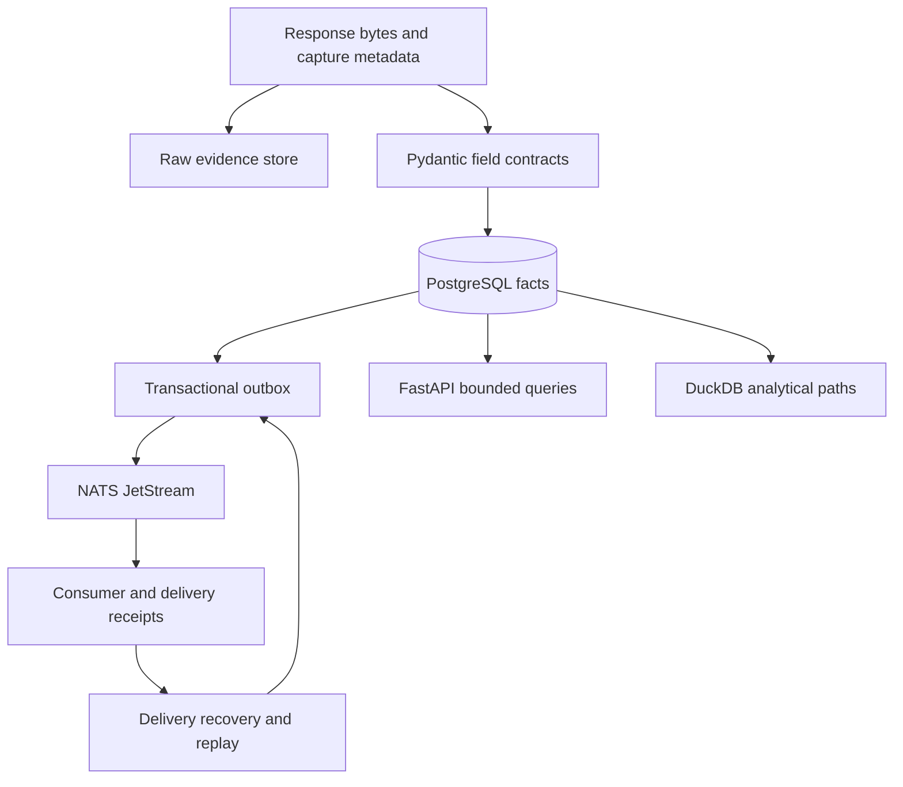

# Market Data Platform

   [](LICENSE)

A Python/FastAPI data backend that keeps the source behind each market observation and makes normalization, delivery and recovery independently inspectable.

Raw response evidence, operational facts, analytical projections and consumer receipts have different lifetimes. This repository models those boundaries explicitly instead of reducing ingestion to “fetch JSON and insert a row.”

## One capture, several responsibilities



The [public contracts](midas_data/contracts.py) require explicit clocks and evidence kinds. Numeric facts retain declared types/units; a valid adapter record does not certify upstream truth. Sensitive credential carriers are rejected from structured capture metadata.

## Data quality is a value, not a missing row

`valid`, `unverified`, `invalid` and `missing` are distinct quality states. `fixture` source data stays a fixture. `original_response` and `legacy_reserialized` distinguish preserved source bytes from reconstructed legacy material.

Two captures can have identical payloads and still represent different requests/times. Capture identity must therefore survive payload deduplication. [FIELD_CONTRACTS.md](FIELD_CONTRACTS.md) and [INTERFACES.md](INTERFACES.md) describe these rules and the consumer-facing boundaries.

## Install the package and run the local suite

The package requires **Python 3.13** (`>=3.13,<3.14`), with pinned dependencies in [pyproject.toml](pyproject.toml).

```console
python -m venv .venv
python -m pip install -e .
python -m pip install pytest==9.1.1
python -m pytest -m "not integration" tests -W error -o addopts= -q
```

Activate the virtual environment before installing. The command excludes separately marked integration tests. The previously recorded offline suite passed after restore/reconcile regressions were made self-contained; it does not provision PostgreSQL, NATS or parent analytical infrastructure.

## Read beyond ingestion

| Implementation | Why it matters |
| --- | --- |
| [delivery.py](midas_data/delivery.py) | Delivery coordination and recovery state. |
| [worker.py](midas_data/worker.py) | Processing boundary behind incoming work. |
| [migrations](midas_data/migrations) | Versioned operational schema. |
| [research_api.py](midas_data/research_api.py) | Research-facing API surface. |
| [paper_replay.py](midas_data/paper_replay.py) | Separate replay/simulation functionality. |

The checkout is a platform slice: parent Compose/private source access and some ClickHouse/DuckLake infrastructure are not bundled. Use [scope and acceptance](DATA_SCOPE_AND_ACCEPTANCE.md) and [migration notes](MIGRATION.md) before integrating it. Paper/research records must remain distinguishable from real executions.

**Technology:** Python 3.13 · FastAPI · Pydantic · asyncpg · PostgreSQL · DuckDB · NATS JetStream · Docker

Project-authored source: [MIT](LICENSE). Third-party components retain their own notices and terms.
