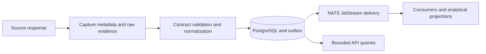

# Market Data Platform

**Auditable ingestion, durable evidence and recoverable event delivery.**

   [](LICENSE)

[Overview](#overview) · [Quickstart](#quickstart) · [Example](#example) · [Validation](#validation) · [Documentation](#documentation)

## Overview

A backend for retaining the source behind a market observation, normalizing it through explicit contracts and delivering it to downstream consumers. The implementation separates raw evidence, operational state, analytical projections and delivery receipts so a failed step can be inspected and replayed.

**Stack:** Python 3.13 · FastAPI · Pydantic · asyncpg · PostgreSQL · DuckDB · NATS JetStream · Docker

## Evidence before derived data

| Component | Behavior |
| --- | --- |
| Capture identity | Metadata keeps the source, request/receive times, evidence kind and a stable capture ID. |
| Exact values | Normalization preserves numeric meaning and units instead of globally converting values to floating point. |
| Quality states | `valid`, `unverified`, `invalid` and `missing` express contract status; fixture evidence remains a fixture. |
| Recovery | Outbox publication and delivery state make pending work and replay boundaries explicit. |

## Processing path



## Quickstart

```console
python -m venv .venv
# Activate .venv, then:
python -m pip install -e .
python -m pip install pytest==9.1.1
python -m pytest -m "not integration" tests -W error -o addopts= -q
```

Use Python 3.13, as declared by the package. The commands exercise the offline suite. Live API ingestion, PostgreSQL, NATS and analytical destinations require the deployment configuration described in the linked interfaces.

## Example

**Follow one capture**

1. Read the original bytes and their request/receive metadata.
2. Validate the capture contract and retain its evidence classification.
3. Normalize supported fields into facts and field observations.
4. Commit operational records and publish pending delivery work.
5. Inspect consumer receipts before treating downstream processing as complete.

The contracts are defined in [contracts.py](midas_data/contracts.py); the data flow and availability semantics are specified in [INTERFACES.md](INTERFACES.md). Two captures with the same payload can still represent different capture events.

## Configuration and storage

Keep source access and deployment credentials outside captured metadata. PostgreSQL is the operational store; DuckDB supports analytical paths. Some analytical interfaces depend on parent infrastructure, including ClickHouse/DuckLake configuration; those references do not provide a standalone deployment here.

## Repository guide

| Location | Responsibility |
| --- | --- |
| [midas_data/contracts.py](midas_data/contracts.py) | Capture, fact and quality contracts |
| [midas_data/delivery.py](midas_data/delivery.py) | Delivery and recovery coordination |
| [midas_data/api.py](midas_data/api.py) | API boundary |
| [midas_data/migrations](midas_data/migrations) | Versioned database changes |
| [tests](tests) | Offline and separately marked integration suites |

## Validation

Python 3.13.16 on Windows: 988 tests and 39 subtests passed with warnings treated as errors; 34 tests were skipped and 203 integration-marked tests were deselected. PostgreSQL, NATS, Docker and live data providers were not started.


The standalone restore-reconciliation helper is included in `scripts/` for its offline regression tests. Running it against real databases requires the parent restore configuration.

These are the last recorded offline checks (20 October 2026), not a new execution triggered by this documentation revision.

## Scope and operational boundaries

This repository is a data-platform slice. Parent Compose configuration and private source access are not bundled. Offline checks do not establish live provider coverage, load capacity or deployment readiness.

## Documentation

- [Interfaces and processing boundaries](INTERFACES.md)
- [Field contracts](FIELD_CONTRACTS.md)
- [Scope and acceptance criteria](DATA_SCOPE_AND_ACCEPTANCE.md)
- [Migration notes](MIGRATION.md)

## License and attribution

Project-authored source code is licensed under the [MIT License](LICENSE). Third-party components and datasets retain their respective rights and licenses.
