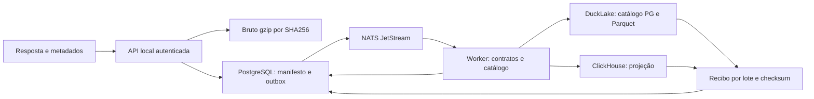

# Base de dados GMGN — operação via Docker

Implementação independente da fundação de dados, autorizada em 2026-09-08. Controle: [TASKS](../TASKS.md), [GOALS](../GOALS.md), [SESSIONS](../SESSIONS.md) e [ownership](../EXECUTION_MAP.md). O projeto Compose é `midas-data`; o legado `midas-fomo` continua separado.

Fundação inicial: [RESULTADOS](RESULTADOS.md). Continuação: [coleta contínua](CONTINUOUS.md), [contratos v3](FIELD_CONTRACTS.md) e [plano histórico](MIGRATION.md). As provas da continuação estão em [CONTINUOUS_RESULTADOS](CONTINUOUS_RESULTADOS.md).

## Fluxo e autoridades



| Camada | Responsabilidade |
|---|---|
| FastAPI + Pydantic | Envelope estrito, autenticação, ingestão limitada, consultas e contrato HTTP OpenAPI autenticado. |
| Bruto em volume Docker | Bytes originais gzip, endereço SHA256, gravação atômica e fsync antes do aceite. JSON inválido também é preservado. |
| PostgreSQL 18 | Manifesto, fatos temporais, campos observados, migrations por checksum, outbox e fronteira de aplicação. |
| NATS JetStream | Transporte recuperável de referências de capturas. O outbox PostgreSQL permite republicar itens não consumidos. |
| DuckDB + DuckLake | Histórico em Parquet, catálogo PostgreSQL, snapshots e recibos por lote. |
| ClickHouse 26.8 | Projeção analítica reconstruível. Consulta de verificação limitada por lote. |
| Python 3.13 + uv.lock | Dependências fixadas; imagens base fixadas por digest em images.lock.json/Compose. |

Um único worker possui o lock de escrita. Entrega pode repetir; IDs, hashes, transações e recibos tornam os efeitos idempotentes. Não existe transação distribuída única entre todos os destinos: um lote só recebe `analytics_applied_at` depois de verificar os dois. Falha parcial permanece pendente para repetição.

## Dados, tempo e qualidade

Identidade do token é `chain + token_address`. Namespaces EVM conhecidos usam endereço hexadecimal minúsculo; Solana preserva caixa. Não há equivalência presumida entre nomes de redes.

| Campo | Significado |
|---|---|
| requested_at / received_at | Instantes declarados pelo coletor para a requisição e recepção, preservados em UTC. |
| source_event_at | Instante declarado pela fonte, opcional; não é inventado a partir de epoch ambíguo. |
| occurred_at / time_basis | Tempo do fato: source quando informado, ou received explicitamente como aproximação. |
| recorded_at | Relógio do banco ao registrar o dado. |
| available_at dos fatos | Fronteira de publicação serializada, após commit dos fatos; nunca retroage para simular disponibilidade histórica. |
| analytics_applied_at | Verificação concluída em DuckLake e ClickHouse; independente do relógio do evento. |

A publicação temporal e as consultas compartilham uma barreira transacional no PostgreSQL. `GET /v1/clock` fornece um `knowledge_cutoff` do mesmo relógio. Reutilize esse corte em todas as páginas; cortes futuros são recusados. Importe hoje um evento antigo e ele aparecerá como conhecido hoje, preservando sua data de origem.

Valores numéricos exatos permanecem em `value_text`; o bruto conserva inclusive a representação original. A coluna auxiliar NUMERIC só é preenchida quando representável dentro do orçamento definido. Não passar preço, supply ou market cap pelo Number do navegador para cálculo exato.

Todo campo observado tem JSON Pointer, categoria, tipo, qualidade e motivo. Estados `missing`, `invalid`, `unverified` e `valid` são diferentes. Desconhecidos continuam no catálogo e no bruto. Zero, false e null não são equivalentes. Listas vazias válidas não viram erro.

Adaptadores ativos: `token_info` e `market_rank`. Outros endpoints podem ser preservados, mas ficam em quarentena de normalização com motivo explícito. O contrato de preço `token_info /price/price` usa USD/token; as demais grandezas ainda sem unidade/janela comprovada permanecem `unverified`. Em particular, market cap reportado não é recalculado com supply presumida nem tratado automaticamente como FDV. `valid` significa aderência ao contrato do adaptador, não certificação econômica de toda a fonte.

`source_kind=fixture`, `gmgn` e `legacy_gmgn` ficam separados em todos os destinos. Toda consulta econômica exige origem. Original e reserializado também ficam identificados em `evidence_kind`.

## Executar

PowerShell 7 e Docker Desktop Linux containers, na raiz do workspace:

```powershell
./scripts/gmgn-data.ps1 init
./scripts/gmgn-data.ps1 up
./scripts/gmgn-data.ps1 status
./scripts/gmgn-data.ps1 test
```

`init` preserva credenciais existentes. O env-file fica em `.data/gmgn-data/runtime.env`, ignorado pelo Git. Não publicar nem imprimir seu conteúdo. A API fica em `http://127.0.0.1:8791`; todos os endpoints exceto `/healthz` exigem `Authorization: Bearer DATA_API_KEY`. Bancos e NATS não publicam portas no host. Somente a API recebe a rede de ingresso; os serviços de dados permanecem na rede interna.

`POST /v1/captures` recebe o corpo original em octet-stream e os metadados JSON no header `x-midas-metadata`. UUID novo por observação; repetir exatamente a mesma captura mantém o UUID; reutilizar com outro conteúdo retorna 409. O aceite 202 confirma bruto + manifesto + outbox, enquanto a normalização continua assíncrona.

| Consulta | Uso e orçamento |
|---|---|
| /v1/clock | Obter corte UTC para navegação histórica. |
| /v1/captures e /{id} | Proveniência, estado, issues e recibos; listagem até 200 capturas recentes da origem. |
| /v1/captures/{id}/raw | Recuperar os bytes e conferir X-Content-SHA256. |
| /v1/observations | Série observada de chain/token/metric, intervalo máximo de 7 dias, até 5.000 fatos por página; `after_seq` e corte fixo. |
| /v1/as-known | Último fato por métrica/unidade/contrato até event_at e knowledge_cutoff. |
| /v1/ingestion | Checkpoint, atraso, ledger e exceções da ponte contínua; até 100 exceções por resposta. |
| /v1/catalog | Catálogo de uma capture_id da origem informada ou até 20 capturas recentes; até 1.000 grupos, com has_more/truncated explícitos. |
| /v1/status | Filas, capturas por estado/origem, projeções pendentes e heartbeat do worker. |

Para consultar uma curva diária observada, use `observations` com a métrica e limites do dia UTC. Os itens vêm em ordem de sequência de ingestão para paginação estável; ordene por `occurred_at` na apresentação. Não são candles interpolados nem reconstrução de ticks ausentes. `include_unverified=false` é o padrão; true exige interpretar a qualidade retornada.

## Recepção real, replay e recuperação

[Importação](IMPORT.md) usa uma leitura limitada da origem, verifica bytes/hash e conserva os relógios. Ela não substitui o coletor contínuo legado nem migra o histórico completo.

```powershell
./scripts/gmgn-data-import.ps1 -Limit 10
./scripts/gmgn-data.ps1 renormalize -SourceKind legacy_gmgn -Limit 10
./scripts/gmgn-data.ps1 replay
./scripts/gmgn-data-recovery.ps1
```

`replay` pausa somente o worker novo, reconcilia lotes já publicados e o retoma. `recovery` é um teste operacional explícito: cria uma fixture, interrompe a API nova, reinicia o broker novo e verifica a recuperação. Não rodar esse teste durante ingestão externa importante.

[Backup e restore](BACKUP.md) preservam bruto, catálogo DuckLake/Parquet e PostgreSQL operacional em uma janela sem escritores. ClickHouse é reconstruído e comparado em outro projeto/volumes. Não usar `down -v` como manutenção.

## Limites desta entrega

Recepção máxima de 4MiB, metadados de 16KiB, profundidade 32, 20.000 nós, 10.000 fatos e saída normalizada de 16MiB. Exceder orçamento preserva a captura aceita e gera quarentena explícita, sem truncamento de fatos aceitos. Queries PostgreSQL têm timeout; sinks limitam memória, lote, resposta e tempo. O snapshot de consumo em repouso e os testes ficam no relatório de resultados, sem alegação de benchmark Big Data.

Esta é uma implantação local de nó único, com limites de recursos e recuperação demonstrável. Não é HA, não tem réplica externa nem recuperação ponto a ponto no tempo (PITR). O backup local deve ser copiado para outro armazenamento se a exigência incluir perda do disco/host. Cobertura total GMGN, primeiros segundos não capturados, migração integral, compactação/retenção em grande escala, homologação das métricas restantes e ensaio de carga representativo continuam etapas próprias.

Estratégias, triggers financeiros, modelos causais/preditivos, marcos de market cap e visualização neural não foram implementados nesta fundação. O dado bruto, sua origem, suas fronteiras temporais e os contratos versionados permitem construir essas camadas depois com evidência.

Referências: [DuckLake com catálogo PostgreSQL](https://ducklake.select/docs/stable/duckdb/usage/choosing_a_catalog_database), [snapshots](https://ducklake.select/docs/stable/duckdb/usage/snapshots), [ClickHouse Docker](https://clickhouse.com/docs/get-started/setup/self-managed/docker).

## Correção de interpretação sem perda de histórico

`renormalize` aplica a versão atual a capturas da origem escolhida que ainda não têm essa versão (até100 por execução). Conserva bytes e resultados anteriores; gera novos fatos/recibos e publica uma nova fronteira. O worker verifica os destinos após retomar. Queries da API selecionam a interpretação mais recente **por captura, disponível no corte informado**. Um corte antigo continua mostrando a interpretação antiga; um corte novo não soma versões da mesma captura. Os logs e as views técnicas dos sinks mantêm todas as interpretações para auditoria: análises SQL diretas devem selecionar a versão elegível antes de agregar.

A amostra real revelou a necessidade de aceitar ranking com envelope duplo de sucesso e corrigir `token_info.launchpad_status` para enum inteiro. A correção recebe `gmgn-p0-v2`; recibos de `gmgn-p0-v1` permanecem intactos. Cotações zero continuam impedidas de passar como preço positivo; seu significado na fonte não foi presumido.
A continuação homologou contratos adicionais em gmgn-p0-v3, preservando v1/v2, e conectou a ponte contínua ao coletor existente. Consulte [resultados da continuação](CONTINUOUS_RESULTADOS.md), [contratos campo a campo](FIELD_CONTRACTS.md), [operação](CONTINUOUS.md) e [plano histórico](MIGRATION.md). A versão da interpretação é distinta da versão do esquema analítico e do snapshot de armazenamento.